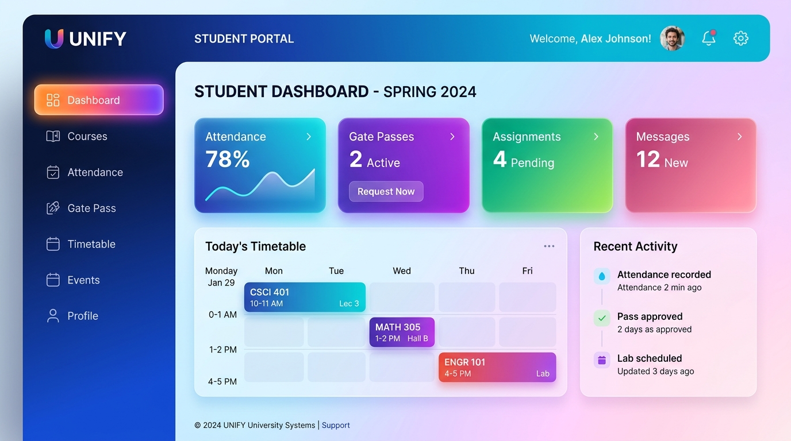
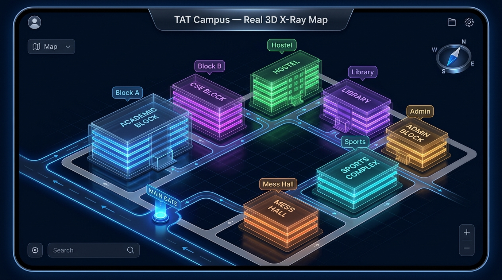

<div align="center">


# UNIFY — Smart Campus Management Portal

### *One Platform. Every Role. Zero Complexity.*

[](https://piyush77777777777.github.io/unify-campus-portal/)
[](https://react.dev)
[](https://vitejs.dev)
[](https://tailwindcss.com)
[](#)
[](#)

</div>


---

## 🎨 Color Grading System — v6.0

<div align="center">

</div>

> **Role-based vivid gradients** — Every portal has its own color identity. Header, sidebar, active nav items, stat cards and background all shift to match the logged-in role.

| Role | Header Color | Sidebar Color |
|------|-------------|---------------|
| 🎓 Student | Blue → Cyan gradient | Navy → Royal Blue |
| 📚 Teacher | Dark → Violet | Dark → Purple |
| 🏠 Warden | Dark → Crimson | Dark → Rose Red |
| 🔒 Guard | Dark → Forest Green | Dark → Emerald |
| 🍽️ Mess Manager | Dark → Orange | Dark → Burnt Orange |
| 👨‍👩‍👦 Parent | Dark → Teal | Dark → Teal-Cyan |
| 🎓 Principal | Dark → Stone Grey | Dark → Warm Grey |

---

## 🗺️ Real 3D X-Ray Campus Map — Full Width

<div align="center">

</div>

> **CSS 3D** — Full-width 580px map with larger buildings (72px grid cells). Transparent X-ray walls, glowing floor slabs, drag-to-orbit 360°, building names on rooftops and floating badges.

---
---


---

## 🗺️ 3D X-Ray Campus Map — Live Preview

<div align="center">

</div>

> **Real CSS 3D** — Buildings with transparent X-ray walls, glowing floor slabs, floating name badges, drag-to-orbit navigation

---
## 🆕 New Features — v3.0 / v3.1

---

### 🗺️ Feature 1 — 3D Campus Navigation


> **Like Google Maps — but built into the student portal**

- Interactive SVG campus map with **7 buildings** (Academic, CSE/IT, Library, Admin, Hostel, Mess, Sports)
- **Real building photos** + floor-by-floor photo explorer
- **Turn-by-turn navigation** — step-by-step directions from Main Gate to any room
- Animated route path, live pulsing location dot, compass rose, scale bar
- Click any building → see **floor plan**, room list, facilities

<table>
<tr>
<td><br/><sub><b>Interactive Campus Map</b></sub></td>
<td><br/><sub><b>Building Detail + Floor Plan</b></sub></td>
<td><br/><sub><b>Turn-by-Turn Navigation</b></sub></td>
</tr>
</table>

---

### 📅 Feature 2 — Smart Timetable System


> **Know exactly where your class is — room, block, floor and teacher**

- Full weekly class schedule with **room number, block, floor & teacher**
- **Live "ONGOING" class** highlighted with green pulse animation
- **Next class alert** shown at the top with exact location
- Day selector with **Today highlighted** in amber
- One-tap Navigate button to go to class

<table>
<tr>
<td><br/><sub><b>Weekly Schedule View</b></sub></td>
<td><br/><sub><b>Class Info — Room, Floor, Block</b></sub></td>
<td><br/><sub><b>Theory & Lab Distinction</b></sub></td>
</tr>
</table>

---

### 🚫 Feature 3 — Disciplinary Actions & Fines


> **Warden issues fines — parents are notified immediately**

- Issue fines for: **drinking, smoking, ragging, gate pass violation, property damage** and more
- **Auto-notifies parents** via SMS + Email the moment a fine is issued
- **Severity levels**: CRITICAL / HIGH / MEDIUM / LOW with color coding
- Fine override option — warden can customize amount
- Full timestamped records of all disciplinary cases

<table>
<tr>
<td><br/><sub><b>Issue Fine Form (Warden)</b></sub></td>
<td><br/><sub><b>Instant Parent Notification</b></sub></td>
<td><br/><sub><b>Disciplinary Case Records</b></sub></td>
</tr>
</table>

---

### 📋 Feature 4 — Per-Class Attendance (No QR Code)


> **Teacher marks attendance manually — no QR code, no scanning, no app install**

- Teacher selects a class session → full **roll call appears**
- Mark each student as **Present (P) / Absent (A) / Late (L)**
- **Mark All Present / Absent** buttons for speed
- Live attendance % per student with **below-75% warning** shown in red
- Progress bar shows how many students marked vs pending

<table>
<tr>
<td><br/><sub><b>Select Class Session</b></sub></td>
<td><br/><sub><b>Roll Call — P / A / L Buttons</b></sub></td>
<td><br/><sub><b>Live % — Below 75% Alert</b></sub></td>
</tr>
</table>

---

### ⭐ Feature 5 — Teacher Feedback System (75%+ Gate)


> **Only students with 75%+ attendance can give feedback — ensuring quality reviews**

- Rate teachers on **5 criteria**: Teaching Quality, Punctuality, Knowledge, Support, Material
- **Anonymous submission** option
- Students below 75% see a **LOCKED screen** with current attendance shown
- Average star ratings visible on teacher cards
- Department can review aggregated scores

<table>
<tr>
<td><br/><sub><b>75%+ Eligible — Teacher List</b></sub></td>
<td><br/><sub><b>5-Star Rating — 5 Criteria</b></sub></td>
<td><br/><sub><b>Locked for Below 75% Students</b></sub></td>
</tr>
</table>

---

## 🏛️ Existing Core Features

<table>
<tr>
<td width="33%">

### 🎫 Gate Pass System


Student → Warden → Guard → Parent notification chain

</td>
<td width="33%">

### 🍽️ Mess Management


Today's menu, weekly reservations, mess dashboard

</td>
<td width="33%">

### 🚌 Live Bus Tracker


3 routes, live ETA, occupancy percentage

</td>
</tr>
<tr>
<td width="33%">

### 📢 Notice Board


Role-based publishing with priority levels

</td>
<td width="33%">

### 🤖 AI Analytics


Campus trends, heatmaps, department stats

</td>
<td width="33%">

### 🔒 Multi-Role Auth


7 portals — student, teacher, warden, guard, mess, parent, principal

</td>
</tr>
</table>

---

## 🔐 Demo Login

| Portal | Email | Code |
|--------|-------|------|
| 🎓 Student | `piyush@tat.ac.in` | `2201106145` |
| 📚 Teacher | `avinash@tat.ac.in` | `FAC-001` |
| 🛡 Warden | `warden@tat.ac.in` | `WAR-01` |
| 🔒 Guard | `guard@tat.ac.in` | `SEC-01` |
| 🍽 Mess Manager | `mess@tat.ac.in` | `MESS-01` |
| 👨‍👦 Parent | `parent@gmail.com` | `2201106145` |
| 🎓 Principal | `principal@tat.ac.in` | `PRIN-01` |

---

## 🛠 Tech Stack

<div align="center">

| Layer | Technology |
|-------|-----------|
| Frontend | React 18 + Vite 8 |
| Styling | TailwindCSS 3 |
| Icons | Lucide React |
| Maps | Custom SVG (zero API cost) |
| State | React Context API |
| Storage | localStorage + Supabase/Firebase ready |
| Deploy | GitHub Pages + GitHub Actions CI/CD |

</div>

---

## 🚀 Run Locally

```bash
git clone https://github.com/piyush77777777777/unify-campus-portal.git
cd unify-campus-portal
npm install
npm run dev
# Opens at http://localhost:5173/unify-campus-portal/
```

---

<div align="center">

## 👨‍💻 Developer

**Piyush Kumar Dey**
`Registration No: 260310533838`
Team: **BUG FINDERS** 🐛
Institution: **Trident Academy of Technology, Odisha**

<br/>

⭐ *Star this repo if you found it useful!*

[](https://github.com/piyush77777777777/unify-campus-portal/stargazers)

<br/>

<sub>Made with ❤️ for Trident Academy of Technology | MIT License</sub>

</div>